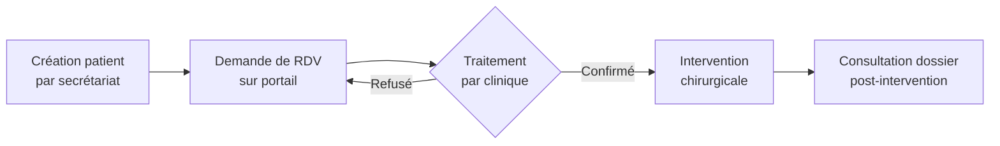

# 2.2 Le parcours du patient

1. Le secrétariat crée le patient : état civil, coordonnées, création de son compte d'accès au portail web.
2. Le patient demande un rendez-vous depuis le portail, en indiquant son motif et ses préférences de créneau.
3. Cette demande **n'est pas un rendez-vous** : elle est traitée par le personnel clinique, qui la **confirme** en lui affectant une salle et un chirurgien, ou la **refuse**.
4. Le patient suit l'avancement de sa demande depuis son espace.
5. Après l'intervention, il consulte son dossier médical : implants portés, historique des interventions, comptes rendus, prochains rendez-vous.

> [!WARNING]
> **Archivage** \
> Un patient peut cesser de fréquenter la clinique (déménagement, changement d'établissement). **Son dossier ne disparaît pas** : les comptes rendus d'intervention sont des documents médico-légaux, conservés bien après le départ du patient. La question posée en cas de litige est toujours *« à quel moment saviez-vous »*, et il faut pouvoir y répondre.

---

[← 2.1 Les implants et leur catalogue](implants.md) · [Sommaire](../../README.md) · [2.3 Le bloc opératoire →](bloc-operatoire.md)
