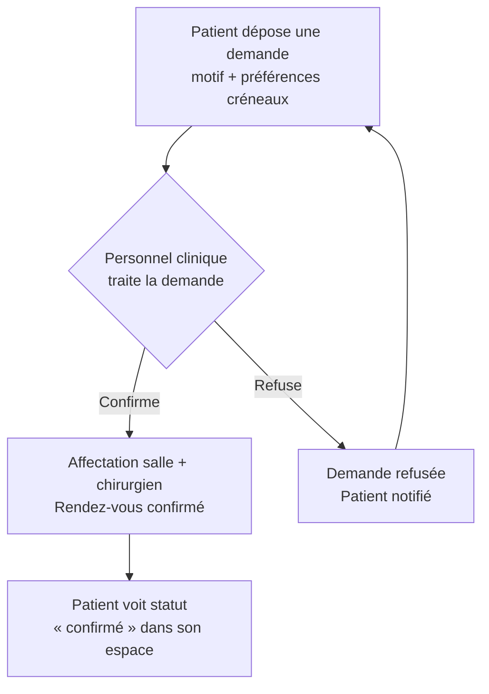

# Partie 3 — Les règles de gestion

> [!CAUTION]
> **Consigne** : \
> Le texte qui suit décrit le fonctionnement attendu du système. Il contient l'ensemble des règles de gestion à respecter. **Votre premier livrable de conception consiste à les identifier, les formuler, les numéroter et les faire valider.** Lisez-le stylo en main : chaque contrainte, chaque interdiction, chaque « jamais » est une règle.

## 3.1 Qui accède à quoi

Le système est utilisé par **quatre profils** qui ne se recouvrent pas :

| Profil | Rôle |
|--------|------|
| **Patients** | Consultation de leur propre dossier |
| **Médecins** | Accès aux dossiers des patients dont ils assurent le suivi uniquement |
| **Personnel administratif** | Gestion des rendez-vous, fiches patients, salles — **pas** d'accès au contenu médical |
| **Administrateurs** | Gestion des comptes, synchronisation catalogue |

> [!WARNING]
> **Règles d'accès**
> - Chacun dispose d'un **compte unique** associé à un **profil unique** — on n'est pas médecin *et* patient à la fois.
> - Le cloisonnement des accès est une **exigence médico-légale**, pas une commodité d'interface.
> - Un compte se **verrouille après 5 échecs d'authentification** consécutifs.

## 3.2 Les patients et leurs implants

- Un patient qui quitte la clinique est **désactivé**, pas effacé — ses comptes rendus sont médico-légaux.
- Aucune manipulation de l'interface ne doit permettre d'effacer un patient et son historique.
- Un patient peut porter **0, 1 ou plusieurs implants**.
- Chaque implant posé est un objet physique unique, gravé d'un **numéro de série**, présent dans un seul corps — deux patients ne peuvent pas porter le même numéro de série.
- Le numéro de série n'est pas inventé par la clinique : il correspond à une unité existante dans le référentiel de la maison mère.

## 3.3 La planification des interventions

Une intervention met en présence : **un patient + un médecin + une salle + un créneau** (heure début + heure fin).

**Contraintes de planification :**

1. Une salle accueille **une intervention à la fois**.
2. Après une intervention, la salle est en **remise en état** (1 heure) — indisponible pour le planning.
3. Un chirurgien est **à un endroit à la fois**.
4. Un chirurgien en **congé ou astreinte** n'opère pas.
5. Chaque chirurgien est **habilité** à certaines familles d'implants seulement — c'est une **responsabilité pénale**.

> Lorsqu'une condition n'est pas remplie, le système **refuse la planification** en supprimant les créneaux horaires initialement renseignés par le patient. Le patient devra alors **reproposer de nouveaux créneaux** pour cette même demande.

**Processus de prise de rendez-vous :**

> - Le patient **voit clairement** que rien n'est acquis tant que la confirmation n'est pas arrivée.
> - Ce n'est **jamais au patient** de choisir sa salle ou son chirurgien.

## 3.4 Les comptes rendus et le suivi

- Chaque intervention produit un **compte rendu** (document médico-légal rédigé par le chirurgien).
- Un compte rendu peut être **enregistré en brouillon** avant publication.
- Une fois **publié**, il est verrouillé — on peut ajouter un avenant, pas modifier.
- Les **notes de suivi** sont des annotations informelles, datées, sans valeur légale.

## 3.5 Gestion du catalogue

- Le catalogue est mis à jour **une fois par trimestre**.
- Seul l'**administrateur** peut lancer la synchronisation avec l'API NeuroLink Corp.

---

[← 2.4 Le dossier médical](02-metier/dossier-medical.md) · [Sommaire](../README.md) · [Partie 4 — Architecture imposée →](04-architecture/README.md)
