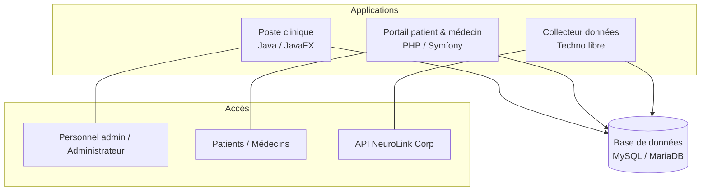

# Partie 4 — Architecture imposée

## 4.1 Architecture globale

## 4.2 Stack technique imposé

| Composant | Technologie |
|-----------|-------------|
| **Poste clinique** | Java / JavaFX |
| **Portail web** | PHP / Symfony |
| **Base de données** | MySQL 8 **ou** MariaDB 10.1+, instance unique partagée |
| **Versionnement** | Git, dépôt distant, **une branche par fonctionnalité** |

> [!NOTE]
> **Libertés de choix** \
> Le reste est libre : bibliothèque d'accès aux données côté Java, framework CSS, stratégie de tests, ordonnancement de la collecte. Ces choix seront à **justifier** dans votre dossier technique.

> [!WARNING]
> **Le respect des conventions** \
> Un dépôt non conventionné est un dépôt illisible : il sera relevé en revue de jalon.
> Les règles de commits, branches, versions, CHANGELOG, README et documentation technique sont détaillées dans [conventions/](../../conventions/README.md).

## 4.3 Environnement technique imposé

| Axe | Sujet | Statut |
|-----|-------|--------|
| 1 | [Architecture réseau et cloisonnement](environnement/axe1-reseau.md) | Obligatoire |
| 2 | [Continuité de service et sauvegardes de la base de données](environnement/axe2-continuite-sauvegardes.md) | Obligatoire |
| 3 | [Sécurité des accès et durcissement](environnement/axe3-securite-acces.md) | Obligatoire |
| 4 | [Traçabilité, détection d'attaques et supervision](environnement/axe4-tracabilite-supervision.md) | Obligatoire |
| 5 | [Automatisation des déploiements](environnement/axe5-automatisation.md) | Optionnel |

---

[← Partie 3 — Les règles de gestion](../03-regles-de-gestion.md) · [Sommaire](../../README.md) · [Axe 1 : Architecture réseau et cloisonnement →](environnement/axe1-reseau.md)
