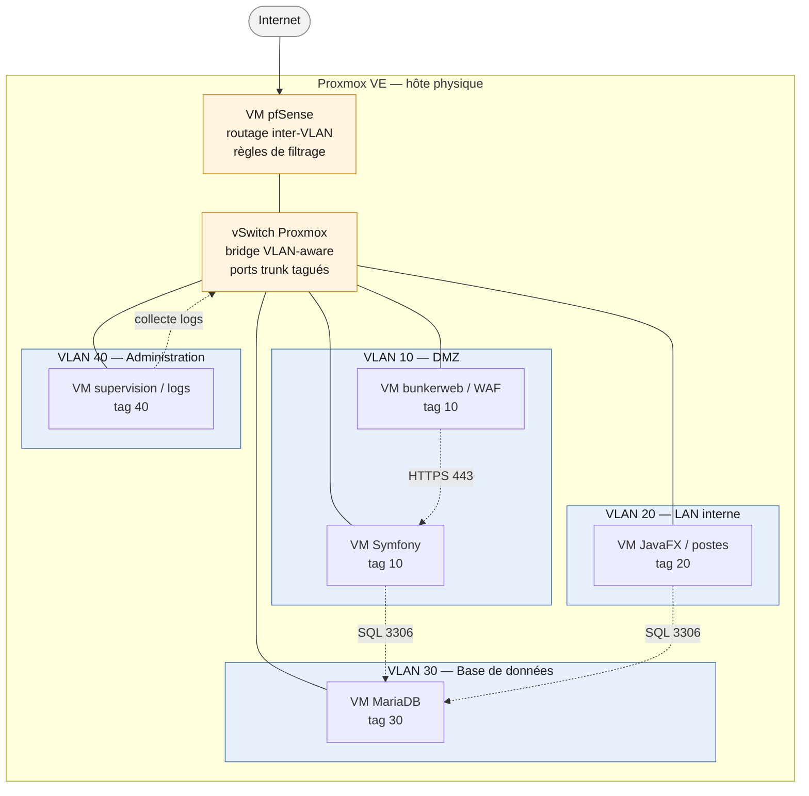

# Axe 1 : Architecture réseau et cloisonnement

**Objectifs**
– Séparer le réseau en zones isolées : le site Web public (Symfony), les postes internes (JavaFX) et le serveur de base de données (MariaDB).
– Protéger les connexions entrantes depuis l'extérieur et permettre aux médecins d'astreinte de se connecter à distance de façon sécurisée.

**Livrables**
– Schéma réseau : plan d'adressage IP, VLANs, DMZ et règles de filtrage entre les zones.
– Pare-feu opérationnel : pare-feu / WAF (ex. pfSense, Nginx) filtrant le trafic HTTPS vers le site.

> [!NOTE]
> **Contrainte d'implémentation** \
> Les VLANs doivent être portés par un **vSwitch Proxmox** (réseau virtuel défini dans Proxmox VE, avec les tags VLAN sur les interfaces des machines virtuelles). Un cloisonnement réalisé uniquement au niveau du pare-feu, sans segmentation VLAN sur le vSwitch, ne satisfait pas l'axe 1.

Le principe : un **vSwitch** porte le trafic étiqueté, chaque VM reçoit un **tag VLAN** sur son interface virtuelle, et le trafic inter-zones remonte obligatoirement au pare-feu.

**Ce que ce schéma impose**

| Élément | Règle |
|---------|-------|
| **vSwitch** | Un seul bridge VLAN-aware sur l'hôte Proxmox, en mode trunk |
| **Tags VLAN** | Chaque interface virtuelle de VM porte un tag unique (10, 20, 30, 40) |
| **pfSense** | Seul point de passage entre VLANs — aucun routage direct VM à VM entre zones |
| **MariaDB** | Isolée dans son VLAN : seules les VM web et JavaFX y accèdent, via le pare-feu |
| **DMZ** | Le WAF et le site public sont ensemble, exposés à Internet, jamais dans le LAN |

> [!CAUTION]
> **Piège à éviter** \
> Deux VM sur des VLANs différents mais branchées sur le **même bridge sans tag** communiquent directement, sans passer par pfSense. Le cloisonnement est alors purement cosmétique : c'est exactement le cas que la revue de jalon sanctionnera.

---

[← Partie 4 — Architecture imposée](../README.md) · [Sommaire](../../../README.md) · [Axe 2 : Continuité de service et sauvegardes de la base de données →](axe2-continuite-sauvegardes.md)
